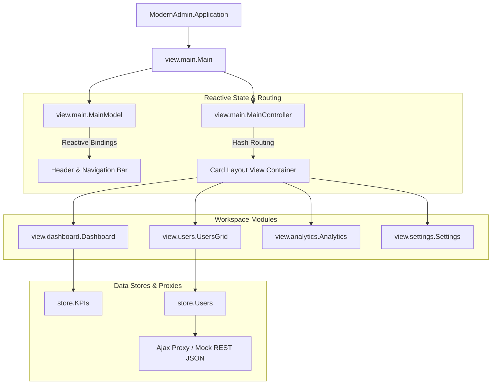

# Acme Enterprise Workspace &mdash; Sencha ExtJS Modern Toolkit

[](https://www.sencha.com/products/extjs/)
[](#architecture)
[](#github-pages-deployment)
[](LICENSE)

A production-grade, enterprise admin dashboard and workspace engineered with **Sencha ExtJS Modern Toolkit** and **MVVM architecture**. Designed for high-density enterprise workflows, responsive device adaptation (desktop, tablet, mobile), and **100% frictionless zero-config deployment to GitHub Pages**.

---

## 🌟 Key Highlights & Capabilities

- **Enterprise MVVM Pattern**: Strict separation of concerns using `Ext.app.ViewModel` reactive state bindings and `Ext.app.ViewController` action pipelines.
- **Collapsible Responsive Navigation**: Smooth animated sidebar with icon-only compact mode, responsive drawer behavior, and hash routing (`#dashboard`, `#users`, `#analytics`, `#settings`).
- **Executive KPI Dashboard**: Summary cards with dynamic trend badges (+14.2%, -2.8%), custom SVG quarterly financial metrics chart, and a live team activity feed.
- **Modern Virtualized Data Grid**:
  - Live search-as-you-type filter across names, emails, and roles.
  - Department dropdown filter.
  - Compound cell renderer combining member avatars, primary names, and emails.
  - Status pill renderers (*Active*, *Pending*, *Suspended*).
  - Client-side CSV export generator.
  - Row action menus.
- **Cloud Telemetry & Infrastructure Health**: Real-time cluster CPU and RAM progress meters, P99 API latency tracking, and edge node registry table.
- **Workspace Security Policies Form**: Modern ExtJS form controls including `Ext.field.Toggle`, numeric slider fields, and security governance fieldsets.
- **Light & Dark Theme Toggle**: Integrated theme switching utilizing modern CSS custom properties and Material Design tokens.
- **GitHub Pages Ready (Zero Friction)**: Does not require proprietary Sencha npm credentials or Sencha Cmd installation—anyone can run it locally with one command or view it live on GitHub Pages.

---

## 🏗️ Architecture Overview



---

## 🌐 Live Demo & GitHub Pages Deployment

### Instant GitHub Pages Setup
This repository includes an automated GitHub Actions workflow at [`.github/workflows/deploy-pages.yml`](.github/workflows/deploy-pages.yml).

1. Push this repository to GitHub.
2. In your GitHub repository:
   - Go to **Settings** &rarr; **Pages**.
   - Under **Build and deployment** &rarr; **Source**, select **GitHub Actions**.
3. Push to `main` and your site will be live at:
   ```
   https://<your-username>.github.io/<repo-name>/
   ```

---

## 💻 Local Development & Quick Start

Because this workspace utilizes modern static distribution standards with relative paths, you can run it with any static HTTP server without heavy SDK build steps:

### Using Node.js (npx serve)
```bash
# Clone the repository
git clone https://github.com/<your-username>/extjs-modern-workspace.git
cd extjs-modern-workspace

# Start local dev server on port 3000
npm start
# or: npx serve . -p 3000
```
Open [http://localhost:3000](http://localhost:3000) in your browser.

### Using Python 3
```bash
python -m http.server 3000
```

---

## 📂 Project Structure

```text
├── .github/workflows/
│   └── deploy-pages.yml        # CI/CD: Automated deployment to GitHub Pages
├── app/
│   ├── model/                  # Data Models
│   │   ├── Base.js             # Base Model schema configuration
│   │   ├── KPI.js              # Executive KPI metric model
│   │   └── User.js             # Enterprise user entity model
│   ├── store/                  # ExtJS Stores
│   │   ├── KPIs.js             # KPI metrics store
│   │   └── Users.js            # Virtualized users store with sorting & filtering
│   ├── view/                   # MVVM Views & Controllers
│   │   ├── analytics/          # Infrastructure & telemetry view
│   │   │   └── Analytics.js
│   │   ├── dashboard/          # Executive dashboard & SVG financial charts
│   │   │   └── Dashboard.js
│   │   ├── main/               # Viewport, responsive sidebar, top app bar
│   │   │   ├── Main.js
│   │   │   ├── MainController.js
│   │   │   └── MainModel.js
│   │   ├── settings/           # Modern workspace settings & form controls
│   │   │   └── Settings.js
│   │   └── users/              # Modern enterprise grid with search toolbar
│   │       ├── UsersController.js
│   │       └── UsersGrid.js
│   └── Application.js          # Ext.app.Application definition
├── resources/
│   ├── css/
│   │   └── custom.css          # Custom styling, elevations, status pills, dark mode
│   └── data/
│       └── users.json          # Mock enterprise JSON dataset
├── app.js                      # Application bootstrapper
├── app.json                    # Sencha ExtJS Application descriptor
├── index.html                  # Entry point with splash loader & relative paths
├── package.json                # Project scripts & metadata
└── README.md                   # Documentation
```

---

## 🛠️ Optional: Building with Sencha Cmd

If your enterprise environment has **Sencha Cmd** and the commercial SDK installed, you can build a minified production bundle using the included `app.json`:

```bash
sencha app build production
```
The compiled output in `build/production/ModernAdmin` can also be deployed directly to any static web host or CDN.

---

## 🛡️ License

This project is open-source under the [MIT License](LICENSE).
